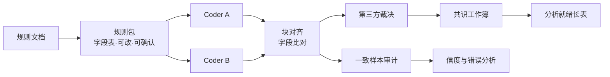

# meta-coding

[](https://github.com/asyazhao/meta-analysis-dual-coder/actions)
[](LICENSE)
[](LICENSE)

> 把一份编码规则、一批论文、三个模型 API，变成**可核对的多模型编码结果、逐字段差异，以及带原文依据的修改建议**。

不是某个课题的脚本——**规则文档是输入**：换一份规则，就换一个研究课题。

**[产品页](https://asyazhao.github.io/meta-analysis-dual-coder/)** · **[本机应用](#本机应用跑真活的地方)** · **[规则包契约](docs/RULE_PACK_SPEC.md)**

---

## 为什么是两个模型 + 一个裁决

一个模型说 `scale_mean = 3.54`，你不知道它对不对。
两个模型都说 3.54，你仍然不知道——它们可能一起错。

所以本项目的核心不是"让模型编码"，而是**让错误可见**：

| 层 | 作用 |
|---|---|
| 双模型独立编码 | 分歧 = 可疑点，把人工注意力从 100% 的单元格压到 5% |
| 逐字段比对 | 精确到「哪个单元格、哪种差异、差多少」 |
| 第三方裁决 | 不投票、不取平均，而是回原文重新判断，再给出建议值 |
| 一致样本审计 | 抽 10% 的**一致**单元格复核，估计"两个模型一起错"的比例 |

最后一条最容易被省掉，但省掉就会系统性低估错误率。

## 工作流



## 现在能跑什么

| 能力 | 状态 |
|---|---|
| PDF 摄取、表格抽取、页码锚定、packet 哈希 | ✅ 21 篇实测 |
| 规则文档 → 字段表 → Schema → 模板契约 | ✅ 含人工确认锁定 |
| 双盲编码（独立进程、提示词逐字节一致） | ✅ 机制完成，`--dry-run` 可验证 |
| V01–V50 结构与口径校验 | ✅ 每条有"破坏→必须命中"用例 |
| 块对齐、字段比对、分歧分类 | ✅ 含顺序打乱仍正确配对的用例 |
| 记录 → 工作簿 → 共识 → 分析长表 | ✅ |
| 第三方裁决 | ⏳ 代码就绪，**未跑过真实调用** |
| 端到端真实编码 | ⏳ **未发生**（无 API key） |

> 没有 key 之前，仓库里不存在任何真实论文的编码结果。全链路用合成数据测过，
> 但别把测试数据当研究结论。

## 快速开始

```bash
git clone git@github.com:asyazhao/meta-analysis-dual-coder.git
cd meta-analysis-dual-coder
make install && make test        # 198 passed
```

**本机应用（跑真活的地方）**

```bash
cp .env.example .env             # 三把 key
make web                         # http://127.0.0.1:8765
```

七页向导：`/keys` → `/rules` → `/papers` → `/run` → `/results` → `/advice` → `/export`。
密钥只写 `.env`，页面只回显「已设置」；服务只监听 `127.0.0.1`。

**命令行**

```bash
meta-coding intake  --batch batch01          # 语料清点
meta-coding rules   build                    # 规则包 → 字段表/Schema/模板
meta-coding ingest  --batch batch01          # PDF → packet
meta-coding code    --coder a --batch batch01 --limit 3 --dry-run
meta-coding diff    --batch batch01          # 块对齐 + 字段比对
meta-coding verify  --all                    # 复算全部 manifest 哈希
```

`--dry-run` 不发任何网络请求：用来看 A/B 提示词哈希是否相等、单篇要多少 token。
**没有 key 也能跑。**

## 规则包：这个工具的通用性所在

规则文档是几万字的人话，字段表要变成机器能校验的东西。中间这一步**不可能全自动**：

```
规则文档 → [模型解析] → 字段表草稿 → [人工逐条确认] → 锁定 → 才允许编码
```

```
rulepacks/<id>/
├── pack.json              来源文档哈希、生成模型、确认状态
├── fields.yaml            名称/类型/取值域/缺失规则/**原文出处**
├── decisions.yaml         分表去向、资格、合并、编号
├── schema/                JSON Schema
└── template_contract.json 列位契约
```

三条硬规则：

1. **每个字段必须带原文出处**——无出处的字段直接丢弃。模型编字段是最难发现的错误，
   下游完全看不出来：21 篇会整齐地按一个虚构字段编码完。
2. **必须人工确认**才允许编码。这是通用化的门禁。
3. 确认后算 `pack_hash` 写入所有 manifest，改规则必须升版本。

## 仓库结构

```
src/meta_coding/
├── ingest/      PDF → packet（页码锚点、表格、哈希）
├── rules/       规则文档 → 字段表 / Schema / 模板契约
├── coders/      提示词渲染、provider 适配器、双盲运行器
├── validate/    V01–V50 + 记录物化
├── adjudicate/  块对齐、字段比对、分歧分类
├── consensus/   共识工作簿、paper_id 编号
├── analysis/    分析长表、完整性矩阵
└── web/         本机控制台（FastAPI + 原生 JS）
docs/            协议文档 + 公共产品页（docs/index.html 由 Pages 发布）
rules/           CODING_PLAN.md 只读副本 + 当前规则包实例
docs/            协议、数据治理、错误分类、规则缺口、偏差记录
artifacts/       每阶段 manifest（可离线复算）
```

## 可复现性

```json
{
  "stage": "06_diff", "git_commit": "…", "rules_hash": "…", "config_hash": "…",
  "outputs": [{"path": "data/05_adjudication/diff_cells.csv", "sha256": "…"}],
  "checks": [{"id": "V01", "status": "pass", "failures": 0}]
}
```

`meta-coding verify --all` 离线复算全部哈希。受限数据（PDF 全文）不进仓，
manifest 标 `external: true`，本地缺失不算篡改。

## 数据与隐私

- PDF、摄取文本、编码结果、作者邮箱：**不进仓库**
- 三把密钥只写 `.env`；页面只回显「已设置」
- 本机应用只监听 `127.0.0.1`；公共页是静态产品页，不含任何密钥
- 引用原文片段每条 ≤ 25 词

## 部署

```bash
gh auth login
git push origin main && git push --tags
```

公开前自检：

```bash
meta-coding verify --all
pytest -q
git ls-files | grep -E '\.pdf$|(^|/)\.env$'   # 必须无输出
```

公共站点：Settings → Pages → Source `Deploy from a branch` → `main` / `/docs`。

提交身份已统一为 `asyazhao@users.noreply.github.com`。

## 局限

1. **共享输入风险**：A/B 读同一份 packet。摄取阶段若表格错位，两个模型会同时继承，
   分歧率因此**低估**真实错误率；一致样本审计只能部分弥补。
2. **模型版本漂移**：厂商静默升级会让"同配置重跑"出现差异。本项目用快照哈希 +
   偏差登记处理，不做"再跑一次取平均"。
3. **规则解析不确定**：规则文档 → 字段表依赖模型，必须人工过一遍。
4. **裁决者自身误差**：裁决模型也是 LLM，`confidence` 未校准。
5. **单批次范围**：`paper_id` 每批次从 1 开始，跨批次合并需另行去重。

## 许可

代码 MIT；文档与报告 CC BY 4.0。引用见 [`CITATION.cff`](CITATION.cff)。
