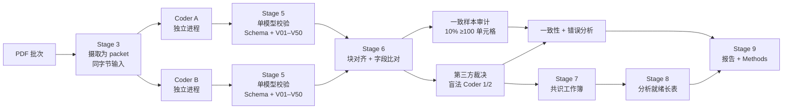

# meta-analysis-dual-coder

内化体重污名（weight bias internalization）元分析的**双模型独立编码 + 第三方裁决**流水线：
把一批论文 PDF 变成两份真正独立的编码、一份带原文证据的裁决记录、一份可直接分析的共识数据集，
全过程可复现、可审计、可校验。

**科学问题**：大语言模型在元分析数据提取上的错误是否可被第二个独立模型发现？
两个模型"一起错"的比例有多高？错误集中在哪些字段和文章特征上？

## 流程图



## 快速开始（无需 API key 即可跑通到 Stage 3）

```bash
git clone <repo> && cd meta-analysis-dual-coder
python3 -m venv .venv && .venv/bin/python -m pip install -e ".[dev]"
cp .env.example .env                 # 三把密钥在 G2 前不必填
meta-coding init                     # 建目录骨架 + 校验配置
pytest -q                            # 全绿
meta-coding --help
```

`--dry-run` 只渲染提示词并计算 `prompt_hash`，不发起任何网络请求，因此在没有凭据时
也能验证双编码员的提示词是否逐字节一致。

## 阶段与产物

| 阶段 | 命令 | 产物 | 验收 |
|---|---|---|---|
| 0 基线 | `meta-coding init` | 配置、治理文档、CI | pytest 绿、`--help` 可用 |
| 1 清点 | `intake --batch batch01` | `corpus_manifest.csv`、`registry.csv` | 每 PDF 恰一角色、重复项有归属 |
| 2 规则锁 | `rules build` | `fields.yaml`、Schema、契约、`rules.lock.json` | 28 字段全映射、验证器有测试 → **G1** |
| 3 摄取 | `ingest --batch batch01` | `packet.json`、`pages.jsonl`、`tables/` | A/B packet 哈希一致 |
| 4 编码 | `code --coder a|b --batch batch01` | 原始响应、解析 JSON、`run_log.jsonl` | pilot 已审 → **G2** |
| 5 校验 | `validate --coder a|b` | `validation_summary.csv`、`repair_log.jsonl` | 无未处理违规 |
| 6 裁决 | `diff` / `adjudicate` | `diff_cells.csv`、`adjudication.jsonl`、`agreement_metrics.json` | 实质分歧全有裁决或入队 |
| 7 共识 | `consensus --batch batch01` | `batch01_consensus_codebook.xlsx`、`provenance.csv` | 读回 0 差异、ID 连续 |
| 8 分析 | `qa --batch batch01` | `analysis_long.csv`、完整性矩阵 | 无 `-999`、排除项有原因 |
| 9 发布 | `report --batch batch01` | 三份报告、release → **G3** | `verify --all` 全 PASS |

## 数据可用性

- **PDF 不公开**。仓库不含任何原文，只保留 SHA-256、页数与文本质量指标。
- `data/00_inbox/`、`data/02_ingest/`–`07_analysis/`、`artifacts/private/` 全部 gitignore；
  L2/L3 数据含受版权全文与作者邮箱，按 `docs/DATA_GOVERNANCE.md` 分级处理。
- 公开产物：`artifacts/public/` 下的小体积报告、manifest、哈希与派生统计。
- 许可：代码 MIT；文档与报告 CC BY 4.0；数据按数据可用性声明单独说明。

## 复现

固定五要素：规则哈希（`configs/rules.lock.json`）、提示词版本与 `prompt_hash`、
模型 ID 与温度、输入 packet 哈希、比对容差。每份 manifest 记录这五项 + git commit，
`meta-coding verify --all` 可离线复算全部哈希，不需要重新调用 API。
模型版本漂移导致的差异会在 `docs/DEVIATIONS.md` 登记并计入局限性。

## 局限性

1. **共享输入风险**：A/B 读取同一份 packet。摄取阶段的表格错位、双栏顺序错误会被两个
   模型同时继承，因此分歧率会**低估**真实错误率；一致样本审计只能部分弥补。
2. **模型版本漂移**：厂商静默升级会使"同配置重跑"产生差异，本项目以快照哈希与
   偏差登记而非"再跑一次取平均"来处理。
3. **单批次范围**：每批次从空白模板独立生成，`paper_id` 从 1 开始；跨批次合并需另行
   去重与语义对齐（见 DEV-001）。
4. **裁决员自身误差**：裁决模型同为大语言模型，其 `confidence` 未被校准；`needs_human`
   与 `critical` 项仍依赖人工兜底。
5. **规则缺口**：`docs/RULE_GAPS.md` 中 `unresolved` 条目在本批次按最具体条款执行，
   不代表已获组内确认。

## 引用

见 [`CITATION.cff`](CITATION.cff)。仓库：<https://github.com/asyazhao>。

## 许可

代码 MIT（见 [`LICENSE`](LICENSE)）；文档与报告 CC BY 4.0。
